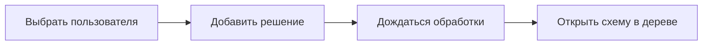

# Руководство пользователя

Краткая справка в приложении (кнопка справки) повторяет эти темы сжато. При изменении экранов или сценариев обновляй и это руководство, и help на сайте.

## Как пользоваться этим файлом

- Пиши простыми словами, теми же названиями кнопок, что на экране.
- Help — коротко; здесь — шаги, ограничения и схемы при необходимости.
- Не оставляй устаревшие кнопки, форматы файлов и порядок действий.

## Начало работы

1. Откройте приложение: сразу главное окно, без полноэкранного выбора пользователя.
2. Выберите или создайте пользователя кнопкой **Выбрать…** слева вверху.
3. Добавьте решение: **+ Добавить решение**, файл Solution.xml или .rar с Solution.xml внутри.
4. Дождитесь оверлея загрузки и обработки. Готовое решение появится в списке и в обозревателе.
5. Откройте схему кликом по узлу дерева.

После сброса базы снова выберите пользователя. Без пользователя загрузка и выбор решений недоступны.

## Обозреватель и поиск

- Дерево слева начинается с папок проектов и схем загруженного решения. Строка «Projects» в обозревателе не показывается. Клик по схеме открывает её на холсте.
- Кнопка **▣** (фильтр дерева) в заголовке обозревателя, рядом с поиском, открывает меню **Показывать в дереве** справа от обозревателя, поверх холста; список схем при этом не прячется. Режимы: **Все схемы** или **Выбранные схемы**. В режиме «выбранные схемы» при открытом меню у проектов, папок и схем появляются галочки. Отметка у проекта или папки включает все вложенные схемы; снятие галочки с части схем оставляет у родителя неполную отметку (не «всё» и не «ничего»). Галочки видны только пока меню открыто. Клик по дереву меню не закрывает; закрытие — повтор **▣**, клик по холсту или инспектору. Пока меню открыто, дерево видно целиком; после закрытия остаются выбранные схемы и путь к ним. Настройка хранится для текущего пользователя и этого решения. Пустой выбор даёт пустое дерево — смените режим или отметьте схемы. Рабочие пространства в режиме «выбранные схемы» скрыты. Фильтр только сужает, что видно в дереве и в поиске; дубликаты, проверки и уже открытая схема по-прежнему опираются на всё решение.
- Кнопка поиска в заголовке обозревателя показывает или скрывает панель. Состояние панели запоминается.
- Поиск по имени, Tag, Id и типу. Запрос короче 2 символов ищет только по Id. Если включён фильтр дерева, в таблице только объекты со схем и проектов, которые фильтр оставил видимыми.
- Клик по строке результата открывает схему и выделяет объект. Если объект не виден — кадр сдвигается к нему. На две секунды вокруг объекта рисуются четыре стрелки; повторный клик по строке показывает их снова. Клик по объекту на схеме стрелок не даёт.
- Индекс поиска обновляется при сохранении или импорте. Несохранённые правки на открытой схеме в поиске не видны.

## Панель инструментов

Опишите здесь каждую кнопку так, как она работает сейчас. Сверяйте с фактическим UI и с секцией «Панель инструментов» в help.

- **Выбрать…** — пользователь сессии.
- **Отображение** — для каждого типа объекта: режим знака (детальный символ, буква, линия для труб), показ на схеме, смещение, поля подписи (Name, Tag, Id и др.), для труб — толщина линии. Переключатель «Показывать подписи на схеме» действует на всю схему. Кнопка **Имена свойств** показывает текущий режим подписей характеристик, команд и защит: **Пользовательское** (описание из XML, если пусто — имя), **Технологическое** (Template или Name из XML), **Оба** (`Status — Статус`, если есть перевод). Клик по кнопке циклически меняет режим; он вступает в силу только после **Применить** и сохраняется для пользователя на сервере (на всех устройствах). Основные поля объекта (Name, Tag, Id, Description, ExternalCode) не переводятся. Если перевода нет, видно только технологическое имя.
- **Проверки** — условия подсветки объектов. Порядок полей: тип объекта → **Область** → параметр → атрибут параметра → условие текста → текст → **Пустое поле** → индикация. **Область** задаёт список параметра: **Основные** — только Id, Name, Tag, Description, ExternalCode; характеристики, команды и защиты — в своих областях. **Атрибут параметра**: «Значение» смотрит значение поля, «Tag параметра» — Tag выбранной характеристики (не путаются). Галка **Пустое поле** / «Допустимо»: если включена, пустое значение не считается нарушением; выпадающего списка нет. «Не должен содержать» ищет заданный текст в выбранном атрибуте.
- **Редактирование TAG** — массовая правка полей объектов выбранного типа на всех схемах. В правиле: **Тип объекта**, **Что проверяем** (Основные характеристики / Характеристики / Команды / Защиты и конкретное поле, как в «Проверках»), **Условие** (содержит / начинается / заканчивается / **Пустое поле**). При «Пустое поле» строка **Текст** скрыта. **Непустой Tag в блоках** — галки Характеристики / Команды / Защиты: объект попадает в выборку, только если во **всех** отмеченных блоках есть непустой Tag. Дальше список **Действий**: какое поле менять, **Очистить** (без «Заменить на») или **Заменить** (поле «Заменить на» и способ: найденное / вся строка / первое / все / последнее совпадение). Можно добавить несколько действий. **Экспорт / импорт** — читаемый JSON правил, его можно править вручную и загрузить после обновления. **Применить** — подтверждение и оверлей на весь экран. Изменённые объекты идут в **Выгрузить объекты → Только изменённые**.
- **Выгрузить объекты** — таблица CSV/JSON по выбранным полям; галка **Только изменённые объекты** и счётчик в скобках сужают выгрузку к объектам со **смысловыми** правками (см. раздел «Изменения и выгрузка»). Можно включить колонку **Template** (тип объекта); список **Тип объекта** сверху фильтрует строки (можно сочетать с «только изменённые»). Для колонки Tag — фильтр: Все / Только непустые / Только пустые (по умолчанию — только непустые). Рядом с галкой — **Обнуление данных по изменённым объектам**: очищает учёт в счётчике и фильтре, не отменяя сами правки в решении. **Сохранить** список и счётчик не сбрасывает.
- **Дубликаты** — поиск одинаковых Tag. Клик по строке в таблице, на вкладке «Дубликаты» инспектора или в плавающей панели открывает схему и выделяет объект; на две секунды вокруг него — четыре стрелки (повторный клик по строке показывает их снова). В «Исключения Tag» типы: «Содержит символ», «Содержит текст», «Содержит один символ» (Tag целиком равен одному символу), «Первый символ» (совпадает первый символ Tag). После поиска можно выгрузить все строки таблицы: формат CSV (`;` и заголовок), TXT (табуляция) или XML (`duplicates` / `row`); колонки Tag, Id, Имя, Тип, Область, Параметр, Схема отмечаются в отчёте, затем **Выгрузить**.
- **Сохранить** — запись правок сессии в решение.
- **Выгрузить XML** — полный Solution.xml с учётом несохранённых правок.

## Схема

Оборудование в режиме «Детальный символ» рисуется картинками объектов схемы. **Угол** и отражения из решения поворачивают картинку вокруг якоря. Если для типа нет файла картинки, остаётся контурный знак. Правка **Угол** во вкладке «Основные» сразу меняет знак на открытой схеме. Подробнее про якорь и картинки — [inst-scheme-pose.md](inst-scheme-pose.md).

- **Буква** — только угол, без зеркала.
- **Трубы** — только линия, без картинок; угол и отражения на них не действуют.
- Несколько точек у оборудования: тонкая ломаная между ними.
- Смещение типа — в **Отображение**, от левого верхнего угла, ползунками. Оверлея сверки с оригиналом нет.

Подписи на схеме задаются только в **Отображение**: отметьте поля и включите «Показывать подписи на схеме», если подписи нужны.

- Масштаб: **+ / − / Fit**.
- Режим **Движение** — выбор и перетаскивание труб, мостов и перемычек; при блокировке режима двигается только оборудование. Не путать с блокировкой объекта в решении.
- Клик по объекту открывает инспектор справа (Основные, Характеристики, Команды, Защиты). Имена характеристик, команд и защит зависят от режима **Имена свойств** в **Отображение**. Если у объекта есть дубликаты основного Tag, справа в строке названия — **Оригинальный объект**. Кнопка сразу ставит основной Tag остальных таких объектов в `*`; вложенные Tag не меняются. Подтверждения нет. Списки дубликатов обновляются на месте. В поиске обозревателя кнопки нет. Копии попадают в **Выгрузить объекты → Только изменённые**, даже если Tag уже был `*`.
- Выбор из Поиска, таблицы Дубликатов, вкладки «Дубликаты» инспектора или плавающей панели дубликатов выделяет объект и на две секунды показывает четыре стрелки вокруг него (если объекта не было в кадре — сначала сдвиг к нему; повторный клик по той же строке в списке снова показывает стрелки). Клик по объекту на схеме стрелок не запускает.
- Перетаскивание фона (зажать и сдвинуть) панорамирует схему и **не** снимает выбор. Короткий клик по пустому месту схемы снимает выбор. Колёсико — масштаб к курсору.
- Drop из WinCC OA записывает имя datapoint в Tag (или в активное поле инспектора).

## Изменения и выгрузка

После правки появляется **● Несохранено**. Метка держится при смене схем, пока правки не записаны **Сохранить**. Сдвиг вида схемы (панорамирование зажатым фоном) тоже может показать **● Несохранено** — это не добавляет объект в список изменённых. Выгрузка только изменённых — в диалоге **Выгрузить объекты**. Найденные дубликаты Tag выгружаются из окна **Дубликаты**, не из «Выгрузить объекты».

### Что попадает в «Только изменённые объекты»

Счётчик и галка **Только изменённые объекты** в **Выгрузить объекты** отражают правки **содержания** объекта, а не его положение на схеме и не настройки отображения.

**Учитываются:**

- поля инспектора: имя, описание, **Tag**, характеристики, команды, защиты и другие параметры во вкладках **Основные**, **Характеристики**, **Команды**, **Защиты**;
- массовое **Редактирование TAG**, если правило реально изменило объекты;
- **Оригинальный объект** (копии с основным Tag «*») — даже если Tag уже был «*».

**Не учитываются:**

- расположение и позиционирование: перетаскивание на схеме, координаты X/Y, угол, размер, видимость объекта в решении;
- настройки **Отображение**: подписи на схеме, какие поля показывать, стиль знака, смещения типа — это только вид в редакторе.

Если меняли только положение или только **Отображение**, объект не попадёт в «только изменённые», хотя **● Несохранено** может остаться из‑за других несохранённых правок.

### Обнуление счётчика

**Обнуление данных по изменённым объектам** в диалоге выгрузки сбрасывает список и счётчик для фильтра «только изменённые». Сами объекты и их правки в решении не откатываются. **Сохранить** счётчик не обнуляет — только эта кнопка.

## Справка в приложении

Кнопка справки открывает модалку с краткими теми же разделами. Если меняете этот файл — проверьте, что help не отстал.
---
