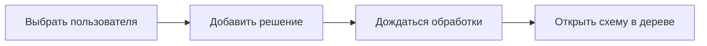

# Руководство пользователя

Краткая справка в приложении (кнопка справки) повторяет эти темы сжато. При изменении экранов или сценариев обновляй и это руководство, и help на сайте.

## Как пользоваться этим файлом

- Пиши простыми словами, теми же названиями кнопок, что на экране.
- Help — коротко; здесь — шаги, ограничения и схемы при необходимости.
- Не оставляй устаревшие кнопки, форматы файлов и порядок действий.

## Начало работы

1. Откройте приложение: сразу главное окно, без полноэкранного выбора пользователя.
2. Выберите или создайте пользователя кнопкой **Выбрать…** слева вверху.
3. Добавьте решение: **+ Добавить решение**, файл Solution.xml или .rar с Solution.xml внутри.
4. Дождитесь оверлея загрузки и обработки. Готовое решение появится в списке и в обозревателе.
5. Откройте схему кликом по узлу дерева.

После сброса базы снова выберите пользователя. Без пользователя загрузка и выбор решений недоступны.

## Обозреватель и поиск

- Дерево слева: проекты и схемы загруженного решения. Клик по схеме открывает её на холсте.
- Кнопка поиска в заголовке обозревателя показывает или скрывает панель. Состояние панели запоминается.
- Поиск по имени, Tag, Id и типу. Запрос короче 2 символов ищет только по Id.
- Клик по строке результата открывает схему и выделяет объект.
- Индекс поиска обновляется при сохранении или импорте. Несохранённые правки на открытой схеме в поиске не видны.

## Панель инструментов

Опишите здесь каждую кнопку так, как она работает сейчас. Сверяйте с фактическим UI и с секцией «Панель инструментов» в help.

- **Выбрать…** — пользователь сессии.
- **Отображение** — символы, подписи, видимость типов на схеме.
- **Проверки** — условия подсветки объектов.
- **Редактирование TAG** — массовое изменение Tag.
- **Выгрузить объекты** — таблица CSV/JSON.
- **Дубликаты** — поиск одинаковых Tag.
- **Сохранить** — запись правок сессии в решение.
- **Выгрузить XML** — полный Solution.xml с учётом несохранённых правок.

## Схема

- Масштаб: **+ / − / Fit**.
- Режим **Движение** — выбор и перетаскивание труб, мостов и перемычек; при блокировке режима двигается только оборудование. Не путать с блокировкой объекта в решении.
- Клик по объекту открывает инспектор справа (Основные, Характеристики, Команды, Защиты).
- Перетаскивание фона — панорамирование; колёсико — масштаб к курсору.
- Drop из WinCC OA записывает имя datapoint в Tag (или в активное поле инспектора).

## Изменения и выгрузка

После правки появляется **● Несохранено**. Метка держится при смене схем, пока правки не записаны **Сохранить**. Выгрузка только изменённых объектов — в диалоге **Выгрузить объекты**. Сброс счётчика изменённых — отдельной кнопкой обнуления, не сохранением.

## Справка в приложении

Кнопка справки открывает модалку с краткими теми же разделами. Если меняете этот файл — проверьте, что help не отстал.
---
